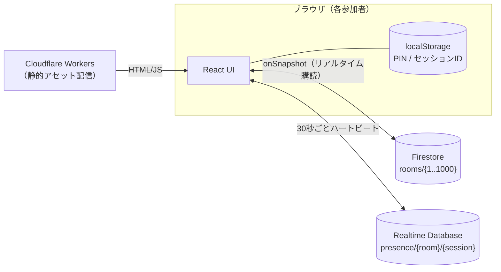

# Tomo Timer

離れた場所にいる人どうしで **同じカウントダウンタイマーをリアルタイムに共有** できる Web アプリです。
ログイン不要。URL を開くだけで誰でもタイマーを見られ、PIN を知っている人だけが操作できます。

**デモ:** https://tomo-timer.hide23.link

```
┌─────────────────────────────────┐
│  [ルーム #42 ▼]     👥 3   🔗   │
│                                 │
│            14:23                │  ← 7セグ表示（全員の画面で同時に進む）
│           ▶ 実行中               │
│                                 │
│   [10分]   [1分]   [リセット]     │
│     [   スタート / ストップ   ]    │
└─────────────────────────────────┘
```

## 特徴

- **ログイン不要** — アカウント登録なし。URL (`/room/42`) を共有するだけ
- **全端末で同じ残り時間** — 毎秒書き込むのではなく「開始時刻＋残り時間」だけを保存し、各端末が計算する方式
- **PIN で操作権を共有** — ルーム作成時に 6 桁 PIN を自動発行。PIN を入れた人は誰でも操作可能（オーナーの概念なし）
- **視聴者数表示** — いま何人がそのルームを見ているかを表示
- **24 時間で自動解放** — ルームは 1〜1000 番のスロット制。作成から 24 時間で期限切れになり再利用される
- **サーバーレス・無料枠で運用** — 静的ファイルは Cloudflare Workers、データは Firebase（Firestore + Realtime Database）

## 生い立ち（sync-timer との関係）

本アプリは、作者が職場の決まったメンバー向けに作った個人用アプリ **sync-timer**（非公開）をベースに、
**不特定多数が使える公開版** として作り直したものです。

| | sync-timer（元） | Tomo Timer（本リポジトリ） |
|---|---|---|
| 想定利用者 | 決まった数人 | 不特定多数 |
| 単位 | 固定 9 グループ | 1〜1000 の使い捨てルーム（24 時間） |
| 操作権限 | Firebase 匿名認証 | ルームごとの 6 桁 PIN |
| データ | Realtime Database | Firestore（タイマー）＋ Realtime Database（視聴者数） |
| 同期方式 | 時刻ベース（終了予定時刻） | 時刻ベース（開始時刻＋残り時間） |

7 セグメント表示の UI と「時刻ベースで同期する」考え方は sync-timer から引き継いでいます。

## 仕組み



### 時刻ベースの同期

Firestore の `rooms/{roomId}` には次の値だけを保存します。

| フィールド | 内容 |
|---|---|
| `state` | `idle` / `running` / `paused` |
| `startedAt` | スタートしたサーバー時刻（`serverTimestamp()`） |
| `remainingAtPause` | スタート時点（または一時停止時点）の残り時間 (ms) |
| `duration` | 設定時間 (ms)、上限 180 分 |
| `pinHash` | PIN の SHA-256 |
| `createdAt` | 作成時刻（有効期限の基準） |

各端末は次の式で残り時間を計算して描画します。書き込みはボタン操作時だけなので、参加者が増えても書き込み回数は増えません。

```
running のとき:  残り = remainingAtPause - (現在時刻 - startedAt)
それ以外:        残り = remainingAtPause
```

端末ごとの時計のズレは、Realtime Database の `.info/serverTimeOffset` で補正しています（`src/firebase.ts`）。

## セキュリティモデルと既知の制限

**ログイン不要を優先した設計のため、PIN は「誤操作防止」の仕組みであり、厳密なアクセス制御ではありません。**
公開前に把握しておいてほしい点をまとめます。

| 項目 | 状態 |
|---|---|
| PIN の検証 | ブラウザ側で行う。Firestore ルールは PIN を検証しないため、SDK を直接使えば PIN なしでもタイマーを操作できる |
| `pinHash` | 誰でも読める。6 桁数字・ソルトなしのため総当たりで復元可能 |
| サーバー側で保証していること | ルーム ID は 1〜1000 のみ／決められた 6 項目以外は書けない（型・範囲チェック）／有効期限内のルームの PIN と作成時刻は書き換え不可（乗っ取り防止）／削除不可 |
| 視聴者数 | セッション ID は UUID 形式・値は過去のタイムスタンプのみ受け付ける |
| ルーム作成数の制限 | 1 ブラウザ 3 個まで（localStorage による制限のため回避可能） |
| 保存される個人情報 | なし（名前・メール・IP アドレスなどは保存しない） |

PIN を本当の認証にしたい場合は、Firebase Authentication（匿名認証）でルームごとにメンバーの UID を登録し、
ルールで `request.auth.uid` を検証する構成への変更が必要です。

Firebase の API キーはクライアントに埋め込まれる公開情報です（[Firebase の公式説明](https://firebase.google.com/docs/projects/api-keys)）。
データの保護はセキュリティルール（`firestore.rules` / `database.rules.json`）で行っています。

## 動かしてみる

### 必要なもの

- Node.js 20 以上
- Firebase プロジェクト（Spark 無料プランで可）
- （公開する場合）Cloudflare アカウント

### 1. Firebase の準備

1. [Firebase コンソール](https://console.firebase.google.com/) でプロジェクトを作成
2. **Firestore Database** を作成（本番モード）
3. **Realtime Database** を作成（ロックモード）
4. プロジェクトの設定 → マイアプリ → ウェブアプリを追加し、設定値を控える

Authentication の設定は不要です。

### 2. 環境変数

```bash
cp .env.example .env.local
```

`.env.local` に Firebase の設定値を記入します（`.env.local` は `.gitignore` 済み）。

```
VITE_FIREBASE_API_KEY=...
VITE_FIREBASE_AUTH_DOMAIN=<project-id>.firebaseapp.com
VITE_FIREBASE_PROJECT_ID=<project-id>
VITE_FIREBASE_STORAGE_BUCKET=<project-id>.firebasestorage.app
VITE_FIREBASE_MESSAGING_SENDER_ID=...
VITE_FIREBASE_APP_ID=...
VITE_FIREBASE_DATABASE_URL=https://<project-id>-default-rtdb.<region>.firebasedatabase.app
```

### 3. セキュリティルールのデプロイ

```bash
npx firebase-tools login
npx firebase-tools deploy --only firestore:rules,database --project <project-id>
```

ルールを入れないと Firestore / Realtime Database は読み書きできません（ロックモードのため）。

### 4. ローカルで起動

```bash
npm install
npm run dev          # http://localhost:5173
```

`vite.config.ts` で `host: true` にしているので、同じ LAN のスマホからも `http://<PCのIP>:5173` で確認できます。

### 5. Cloudflare Workers へデプロイ（任意）

`wrangler.toml` は `dist/` を静的アセットとして配信し、SPA のルーティング（`/room/42` など）に対応する設定です。

```bash
npm run build
npx wrangler deploy
```

ビルド時に `.env.local` の値が埋め込まれるため、Workers 側に環境変数を設定する必要はありません。
Firebase 側で API キーの利用元を自分のドメインに制限しておくことをおすすめします
（Google Cloud コンソール → API とサービス → 認証情報 → HTTP リファラー制限）。

## ディレクトリ構成

```
src/
├─ App.tsx                 画面全体・ルーティング（/ と /room/:id）
├─ firebase.ts             Firebase 初期化・サーバー時刻補正
├─ types.ts                RoomData 型・定数（ルーム数・有効期間）
├─ components/
│  ├─ RoomSelector.tsx     ルーム一覧（24 時間以内のルームを新しい順に最大 30 件）
│  ├─ TimerDisplay.tsx     7 セグ表示
│  ├─ TimerControls.tsx    10分 / 1分 / リセット / スタート・ストップ
│  ├─ ShareButton.tsx      PIN 表示・共有・PIN 入力
│  └─ ViewerCount.tsx      視聴者数
├─ hooks/
│  ├─ useRoom.ts           Firestore のリアルタイム購読
│  ├─ useRoomActions.ts    スタート・一時停止・リセット等の書き込み
│  ├─ useTimer.ts          残り時間の計算と表示更新
│  └─ usePresence.ts       視聴者数（RTDB ハートビート）
└─ utils/
   ├─ roomAlloc.ts         空きルーム探索・PIN 生成
   ├─ pin.ts / hash.ts     PIN の保存・SHA-256
   ├─ myRooms.ts           自分が作成したルーム（最大 3 個）
   ├─ room.ts              ルーム ID 検証・有効期限判定
   └─ session.ts           視聴者数用のセッション ID
firestore.rules            Firestore セキュリティルール
database.rules.json        Realtime Database セキュリティルール
firebase.json              ルールのデプロイ設定
wrangler.toml              Cloudflare Workers 設定
SPEC.md                    詳細仕様
```

## 技術スタック

React 19 / TypeScript / Vite / React Router / Firebase（Firestore・Realtime Database）/ Cloudflare Workers（静的アセット）/
7 セグフォント [DSEG](https://github.com/keshikan/DSEG)（SIL Open Font License、CDN から読み込み）

## ライセンス

[MIT](LICENSE)
